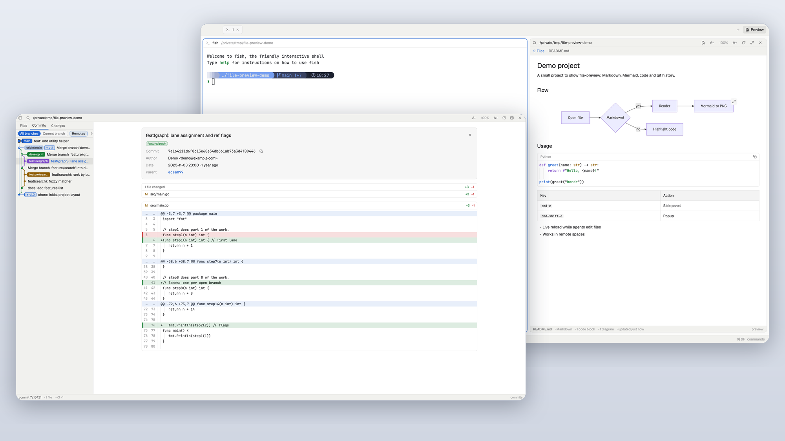

# file-preview

A [Herdr](https://herdr.dev) mod that shows a file tree of the focused terminal's folder
next to a rendered preview of the selected file: Markdown with highlighted code fences
and Mermaid diagrams, plus syntax-highlighted source files. It works in local and remote
spaces, reloads live while agents edit files, and opens as a near-full-screen popup or
as a panel docked to the right of the terminal.



## Features

- **File tree** of the focused terminal's working directory. Folders load lazily when
  you expand them. All dotfiles are shown except `.git`. The tree is capped at 500
  entries per folder and 5000 in total.
- **Follows the focused terminal.** Focus another terminal or `cd`, and the root moves
  with it. Focusing the preview itself, or another mod, keeps the last root, so the
  panel doesn't jump when you click into it.
- **Markdown**: CommonMark + GFM (tables, task lists, quotes, strikethrough, links).
  Relative links to `.md` files open inside the mod, and external links open in your
  browser (local spaces only). Embedded images show as their alt text.
- **Highlighted code fences** in Markdown, one read-only editor per fence, sized to
  its text. Each fence has a header with its language and a **copy button** that puts
  the fence's content on the clipboard ("Copied" confirms it). The wheel over a fence
  scrolls the document, not the fence.
- **Mermaid diagrams**: ` ```mermaid ` fences are rendered to PNG locally with
  mermaid-cli and cached. If mermaid-cli or a browser is missing, you see the diagram
  source with a notice and a Retry button.
- **Expanded diagrams**: the expand button in a diagram's top-right corner opens it
  fitted to the whole view, with zoom (`+`, `-`, `0` for fit), the zoom level and
  scrollbars on both axes. Zooming past the cached image's resolution renders a sharper
  copy (at twice the pixels) in the background and swaps it in. In the popup it covers
  the popup; from the panel it opens as a dialog over the window.
- **Reading zoom** from 70 % to 200 %: one level scales the Markdown prose (headings,
  tables and inline code too), code fences, the code view and diagrams together; the bars
  and the tree keep their size. Use `+` / `-` / `0`, or **A−** / **A+** in the top bar
  (click the percentage to reset). The popup and the panel each remember their level.
- **Hide the file tree** at any width with the sidebar button at the top left or `b`.
  The popup and the panel each remember the choice.
- **Code view** with syntax highlighting for JavaScript/TypeScript, Bash/sh/zsh, Python,
  C, Go, JSON (also jsonc, jsonl, ndjson, json5, geojson) and YAML (also yml, and TOML
  as an approximation). JSON is always soft-wrapped, so minified one-line files are
  readable. Other text files are shown as plain text.
- **Two modes**: a popup that covers 95 % of the window, and a right panel that takes
  45 % of the tab. The popup's anchor button turns it into a panel that keeps the
  current file open.
- **Remote spaces**: the tree, file reads and live reload all work on remote Unix
  machines. Diagrams are always rendered on the local machine.
- **Live reload**: the open file and the expanded folders update as files change. Local
  spaces use a file watcher. Remote spaces poll: every 2.5 s for the open file and every
  10 s for the tree.
- **Limits**: files over 1 MB are truncated with a notice, and binary files show
  "Binary file · no preview".
- Uses your Herdr theme colors (light and dark), including for syntax highlighting.

## Requirements

- **Herdr app** on macOS or Linux. Remote spaces need a Unix machine with `sh` and `stat`.
- **Optional, for Mermaid diagrams:**
  - [`@mermaid-js/mermaid-cli`](https://github.com/mermaid-js/mermaid-cli) (`mmdc`):
    `npm install -g @mermaid-js/mermaid-cli`
  - **Google Chrome or Chromium** (Brave and Edge also work). `mmdc` installs no
    browser here: the mod finds one and passes it to puppeteer. It checks
    `$PUPPETEER_EXECUTABLE_PATH`, `/Applications` and `~/Applications` on macOS, and
    `google-chrome`, `google-chrome-stable`, `chromium` and `chromium-browser` on Linux.

  > **About `PATH`.** Programs started by a mod get a minimal `PATH`, without Homebrew
  > or Node version managers. The mod looks for `mmdc` in this order:
  > 1. The `MMDC` constant at the top of `mods/file-preview/mermaid.js`, if you set it
  >    to an absolute path.
  > 2. **fnm's default alias**: `~/.local/share/fnm/aliases/default/bin/mmdc`. If you
  >    use fnm, install mermaid-cli under the Node version that is your fnm default.
  > 3. The minimal `PATH`.
  > 4. A login shell: `fish -lic` or `$SHELL -lic`, then `command -v mmdc`.
  >
  > With nvm, volta or another manager, set `MMDC` to the absolute path of `mmdc`.

Without mermaid-cli everything else works, and diagrams appear as source code.

### What the mod runs and reads

As the herdr.dev guidance asks, here is what the mod does outside its own folder:

- It **runs programs** with `exec`: `sh` (folder listings, `stat`, file probes),
  `node` with `mmdc`, which starts headless Chrome, and `open` or `xdg-open` for links
  you click. Login shells are only used to look up `mmdc`.
- It **reads files anywhere** under the folder you browse, on local or remote machines.
- It **writes only** to `~/.config/herdr-app/mods/file-preview/.cache/` (rendered
  diagrams and the puppeteer config).
- It makes **no network requests**: no content leaves your machine.

## Install

1. Copy the mods into Herdr. **Copy them; don't symlink.** With a symlinked mod folder,
   the mod loads but its SVG icons don't draw.

   ```sh
   scripts/sync.sh     # rsync mods/* -> ~/.config/herdr-app/mods/ (or $HERDR_APP_HOME/mods/)
   ```

   This installs two mods: `file-preview` (the viewer) and `file-preview-panel` (a tiny
   launcher that docks the viewer as a right panel). The script removes any old symlink
   first. It also refuses to run if the two copies of `dock.js` differ.

2. Merge the shortcuts from [`keys.json`](keys.json) into `~/.config/herdr-app/keys.json`:

   ```json
   {
     "global": {
       "cmd-e": "mod.open:file-preview",
       "cmd-shift-e": "mod.open:file-preview-panel"
     }
   }
   ```

3. Optional: run `herdr-app check ~/.config/herdr-app/mods/file-preview` and
   `herdr-app check ~/.config/herdr-app/mods/file-preview-panel`.

## Shortcuts

| Key | Action |
|---|---|
| `cmd-e` | Open or close the popup |
| `cmd-shift-e` | Open or close the right panel of the current tab |

Inside the mod:

| Key | Action |
|---|---|
| `↑` `↓` | Move in the tree (`Home`, `End`, `PageUp`, `PageDown` too) |
| `→` | Expand a folder, or step into it |
| `←` | Collapse a folder, or go to its parent |
| `Enter` / `Space` | Open the file, or toggle the folder |
| `Tab` | Switch focus between the tree and the preview |
| `r` | Reload the tree and the file |
| `b` | Hide or show the file tree (remembered separately for the popup and the panel) |
| `+` (or `=`) / `-` | Reading zoom in / out (70 % to 200 %; remembered separately for the popup and the panel) |
| `0` | Reading zoom back to 100 % |
| `Esc` | Close the popup |

In an expanded diagram:

| Key | Action |
|---|---|
| `+` (or `=`) / `-` | Zoom in / out (steps of 1.25×) |
| `0` | Back to fit |
| `Esc` | Close the expanded diagram (the popup stays open) |

The top bar also has buttons for the tree, reading zoom (A−, the percentage, A+),
reload, anchor (popup only: dock as a panel)
and close. An expanded diagram's bar has zoom out, zoom in, fit and close.

## Limitations

- The panel takes **45 % of the tab only when the terminal is alone in its row**. If the
  terminal already shares a row with other panes, the panel joins that row and gets a
  smaller share. Herdr has no API that exposes the tab's split tree.
- **One panel per tab.** Anchoring from the popup replaces the tab's existing panel.
- At 45 % on a laptop screen the panel is usually under 600 px wide. Until you hide or
  show the tree yourself, it then opens with the tree unfolded over the preview (folded
  after the popup's anchor button), and `b` folds it away.
- Long lines in a code fence (other than JSON, which wraps) scroll sideways with the
  trackpad, but the fence shows no horizontal scrollbar.
- An expanded diagram scrolls with the wheel, the trackpad or its scrollbars; there is
  no drag to pan, and zooming doesn't keep the point under the pointer in place.
  The sharper render is capped at `-s 4`, so past 200 % (the percentage shown) the
  image is upscaled a little.
- Above 100 % reading zoom, diagrams in the document are the cached `-s 2` image scaled
  up, so they are a little soft; the expanded view renders a sharper copy.
- Leaving an expanded diagram in the popup puts the document back at its top: Herdr
  can't read or restore a scroll position.
- macOS and Linux only; remote spaces must be Unix. **Windows is not supported.**
- Mermaid needs Chrome or Chromium on the local machine. Each diagram renders once
  (about 1 s warm, about 5 s cold) and is cached by content and theme.
- Embedded Markdown images, PDF, CSV-as-table and HTML rendering are out of scope.
  The mod is read-only.

## Troubleshooting

- **A yellow notice on a diagram** ("Install @mermaid-js/mermaid-cli…" or "Mermaid needs
  Google Chrome or Chromium") means the mod couldn't find `mmdc` or a browser. Install
  the missing piece and press **Retry** on the notice. If `mmdc` still isn't found, set
  `MMDC` in `mermaid.js` (see Requirements) and rerun `scripts/sync.sh`.
- **A red notice on a diagram** shows mermaid-cli's error, which usually means a syntax
  error in the diagram. Fix the source; **Retry** renders it again.
- **"Cannot reach <machine>"** in the tree: the remote machine is offline. The last
  loaded tree stays visible. Press **Retry** when the machine is back.
- **Nothing happens, or the mod looks broken:** run `herdr-app status` and look at
  `errors`, then run `herdr-app check ~/.config/herdr-app/mods/file-preview` (and
  `file-preview-panel`).
- **Icons are missing:** the mod folder is probably a symlink. Remove it and install
  with `scripts/sync.sh`.

## Repository layout

```
mods/file-preview/         the viewer (main.js, tree.js, source.js, markdown.js, lang.js, mermaid.js, zoom.js, dock.js, icons/)
mods/file-preview-panel/   launcher for the right panel (main.js, dock.js copy)
scripts/sync.sh            install / update into ~/.config/herdr-app/mods/
scripts/make-big-md.sh     generates docs/fixtures/big.md (> 1 MB, not versioned)
docs/fixtures/             test documents: every language, Mermaid, tables, binary
keys.json                  shortcut snippet to merge
RECIPE.md                  brief for rebuilding the mod from scratch
LICENSE                    MIT
```

## License

[MIT](LICENSE)
