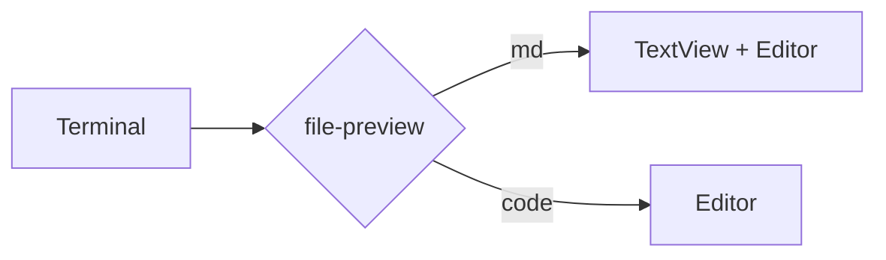

# All languages

One fence per language and alias. Aliases the Editor does not know (`shell`, `golang`,
`zsh`, `console`, `ts`, `jsx`, `h`) are normalized by `lang.js`, so every block should be highlighted. See [tables](tables.md)
and [the recipe](../../RECIPE.md).

## JavaScript (`js`, `javascript`, `ts`, `jsx`)

```js
const answer = 42; // comment
export function hello(name) { return `hi ${name}`; }
```

```javascript
class Box { constructor(v) { this.v = v; } }
```

```ts
let n: number = 1 + 2;
```

```jsx
const App = () => <div className="x">{"text"}</div>;
```

## Bash (`bash`, `sh`, `shell`, `zsh`, `console`)

```bash
for f in *.md; do echo "$f"; done
```

```sh
[ -d "$HOME" ] && echo "home exists" # comment
```

```shell
export PATH="$HOME/.local/bin:$PATH"
```

```zsh
if [[ -n $ZSH_VERSION ]]; then print "zsh"; fi
```

```console
ls -la | grep "md" > out.txt
```

## Python (`python`, `py`)

```python
def greet(name: str) -> str:
    return f"hello {name}"  # comment
```

```py
import sys; print(sys.version, 3.14, None, True)
```

## C (`c`, `h`)

```c
#include <stdio.h>
int main(void) { printf("%d\n", 42); return 0; }
```

```h
typedef struct { int x; char *name; } point_t;
```

## Go (`go`, `golang`)

```go
package main
import "fmt"
func main() { fmt.Println("hello", 42) }
```

```golang
type T struct{ N int }
```

## JSON (`json`, `jsonc`) and YAML (`yaml`, `yml`)

```json
{ "name": "file-preview", "version": 3, "ok": true, "none": null, "tags": ["a", "b"] }
```

```jsonc
// comments are allowed in jsonc
{ "ratio": 0.45, "nested": { "deep": [1, 2, 3] } }
```

```yaml
name: file-preview  # comment
limits: { per_folder: 500, ratio: 0.45 }
tags: [a, b]
```

```yml
- id: local
  remote: false
- id: "203.0.113.10"
  remote: true
```

Minified JSON (one long line, soft-wrapped):

```json
{"kind":"catalog","version":3,"items":[{"id":0,"name":"item-000","tags":["alpha"],"price":0.0,"active":true,"owner":null},{"id":1,"name":"item-001","tags":["alpha","beta"],"price":1.37,"active":false,"owner":{"user":"u1","email":"u1@example.com"}},{"id":2,"name":"item-002","tags":["alpha","beta","gamma"],"price":2.74,"active":true,"owner":{"user":"u2","email":"u2@example.com"}},{"id":3,"name":"item-003","tags":["alpha"],"price":4.11,"active":false,"owner":{"user":"u3","email":"u3@example.com"}},{"id":4,"name":"item-004","tags":["alpha","beta"],"price":5.48,"active":true,"owner":{"user":"u4","email":"u4@example.com"}},{"id":5,"name":"item-005","tags":["alpha","beta","gamma"],"price":6.85,"active":false,"owner":null},{"id":6,"name":"item-006","tags":["alpha"],"price":8.22,"active":true,"owner":{"user":"u6","email":"u6@example.com"}},{"id":7,"name":"item-007","tags":["alpha","beta"],"price":9.59,"active":false,"owner":{"user":"u7","email":"u7@example.com"}},{"id":8,"name":"item-008","tags":["alpha","beta","gamma"],"price":10.96,"active":true,"owner":{"user":"u8","email":"u8@example.com"}},{"id":9,"name":"item-009","tags":["alpha"],"price":12.33,"active":false,"owner":{"user":"u9","email":"u9@example.com"}}]}
```

## Unknown and plain fences

```
plain fence without info string
```

~~~text
tilde fence, "text" info string
~~~

## Mermaid (M1: shown as plain code)



## GFM

| Left | Center | Right |
|:-----|:------:|------:|
| a    |   b    |     c |
| `code` | **bold** | ~~gone~~ |

- [x] done task
- [ ] open task

> A quote with a [link](https://herdr.dev).
