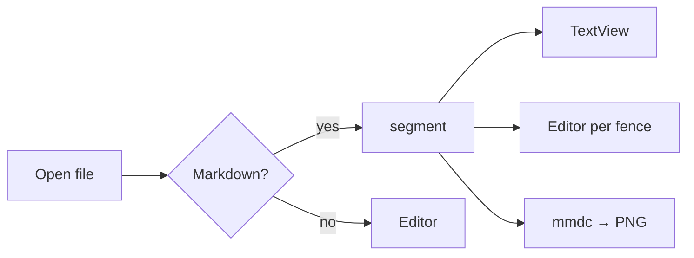
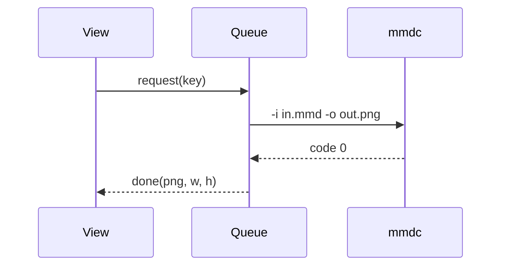
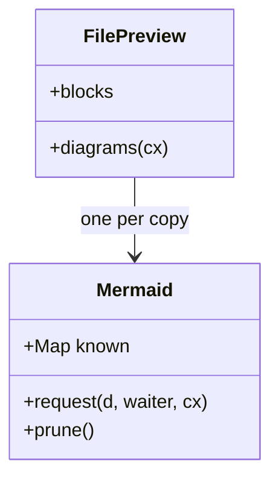
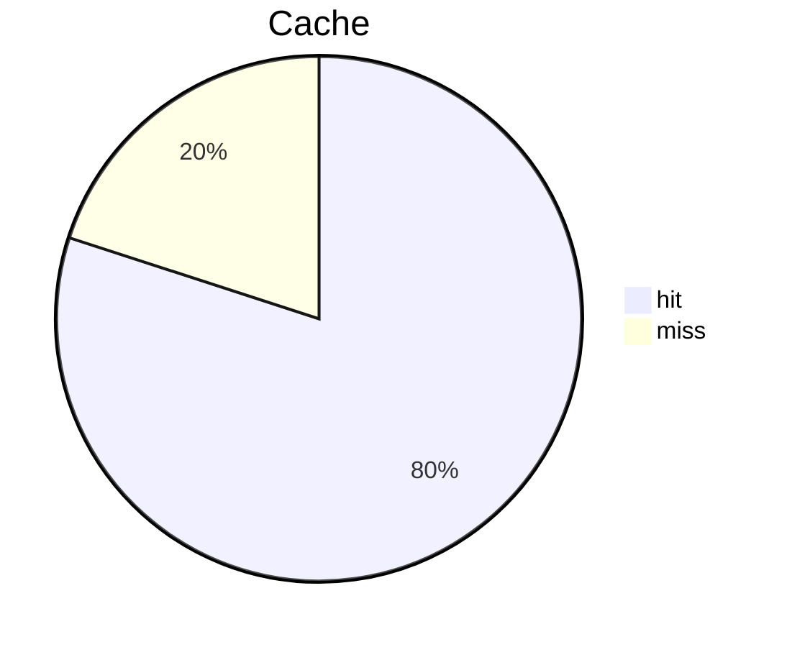

# Mermaid fixture

Prose before the first diagram. Editing this paragraph must not re-render any diagram.

## Flowchart



## Sequence diagram



## Class diagram



## Broken diagram (fallback with the error)

```mermaid
flowchart TD
  A --> B -->
  ((( broken
```

## Two identical diagrams (one render, two images)



Some prose between the twins.


Prose after the last diagram.
